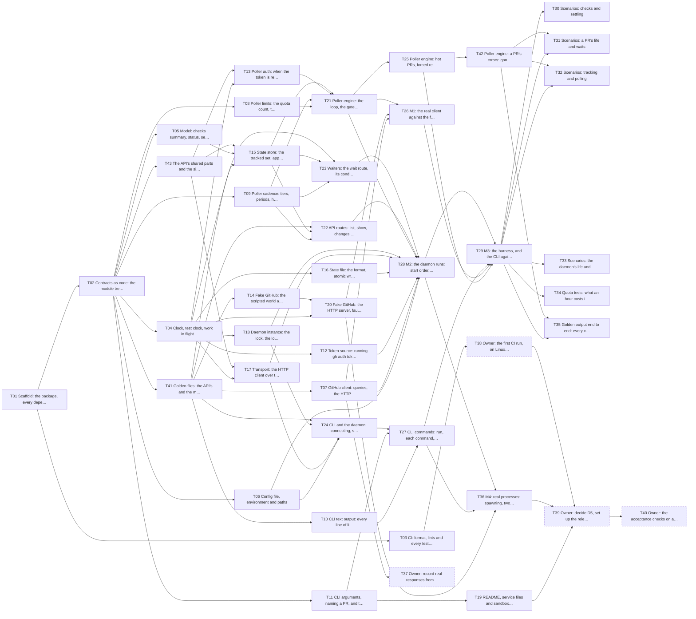

# circitor implementation plan

**Built from:** the specs as of 2026-11-25 (draft 0.1, hardened through pass 3); the snapshot is in `graph.json`. **Scope:** the whole system. **Tool:** `python3 -I .claude/skills/build-plan/scripts/plan.py <command>` (`plan.py` below).

<!-- plan:status -->
_Generated 2026-11-25._ **43 tasks:** 43 todo. **9 waves**, critical path weight 23. **Coverage:** 131 of 131 requirements.
<!-- /plan:status -->

The orchestrator reads this file, `conventions.md` and `contracts/README.md`. An executor reads `conventions.md`, the contract files its task cites, and its task.

## Sources of truth

- `specs/` for behaviour; the facts docs (`docs/02-github-api.md`, `docs/03-clients.md`, `docs/04-platform.md`) for what GitHub, the clients and the platforms do; this plan for order, ownership and interfaces.
- A spec question is the user's. Nobody resolves one by editing a spec, a test or a contract on their own.

## Milestones

| Milestone | Checkpoint: what runs end to end | Integration task |
|---|---|---|
| **M1 Poll** | In one process on the test clock, the engine polls the fake GitHub through the real client. PRs are found and tracked with the right status and revisions; a push and a merge are seen as the specs say; an hour's points stay inside the budget. | T26 |
| **M2 Serve** | A whole daemon starts in STA-11's order and answers on a Unix socket in a temp directory. PRs come in through polls; waits end satisfied, ended and timed out; a client that disconnects leaves no waiter; a stop leaves no socket and a valid state file. The demand side (T25) isn't needed yet. | T28 |
| **M3 CLI** | The harness runs every CLI command as a function against the in-process daemon and the fake GitHub, with output and exit codes; a command with no daemon starts one through the fake spawner; a waiter makes its PR hot; an untracked PR is read through. | T29 |
| **M4 Operate** | The built binary as real processes: the CLI starts a daemon that outlives it, two CLIs leave one daemon, an older daemon is replaced, the fake `gh`, the lock, the stale socket, permissions. The README and service files exist. | T36 (with T19, T03) |
| **M5 Harden** | Every TST-8 scenario, TST-6's quota figures and TST-7's golden output pass with no ignored test. Then the owner's checks. | T30 to T35; then T37 to T40 |

M5 has no single integration task: it's reached when T30 to T35 are done **and no test is `#[ignore]`d**. Each ignored test names the task whose code is wrong; the orchestrator turns each into a follow-up fix task (the next free ID, depending on the task it fixes).

## Running the swarm

### Each round

1. `plan.py ready` lists the tasks that can start, most urgent (longest remaining path) first.
2. Start up to **four** executors at once, one per task, each in its own git worktree (Agent tool, `isolation: "worktree"`), with the prompt below. Then `plan.py status Tnn in-progress`.
3. When an executor returns, set `review`, read its report, and check the diff: only its `owns` and `shares` paths changed; the contracts are kept; every requirement in its frontmatter is accounted for; the tests prove the acceptance rather than mirror the code. Run its acceptance commands and `make verify` in its worktree yourself.
4. Accepted: commit on a branch in the repository's style and merge in wave order, rebasing the later ones; run `make verify` on main. Then `plan.py status Tnn done`, add an **Evidence** section to the task (date, commands and results, branch or PR), and `plan.py render`.
5. Not accepted: send the gaps back to the same executor (SendMessage keeps its context), or set `blocked` and write down why.

**The first two tasks run alone.** T01, then T02: every other task starts from T02's commit. T43 (the API's shared parts and the fakes) and T41 (the golden files) come straight after and unblock the fourth wave: start them first. Review T02 against `contracts/` line by line before anything else starts; a wrong declaration there is built on forty times. T02 leaves `unimplemented!("Tnn")` stubs: between T02 and T27 the binary panics on every command, which is expected.

**The repository has no commit yet.** Before T01, commit what's there (`docs/`, `specs/`, `plan/`, `.claude/`, `CLAUDE.md`, `README.md`): a worktree needs a commit to start from, and executors must be able to read the plan.

### Executor prompt

```text
Implement task <Tnn> of the circitor implementation plan in this git worktree.
1. Read plan/conventions.md, then plan/tasks/<file>, then everything its "Read first" section lists.
2. Build what its Scope says, inside the paths in its frontmatter `owns` (and `shares`, only as the task describes). Don't edit specs/, docs/ or plan/.
3. Meet every Acceptance item: write the tests it names, run the commands it lists and `make verify`, and fix what fails.
4. If a contract, the spec or another task's code stops you, don't work around it, and don't change behaviour to make a test pass: report it as an open item.
5. Don't commit, push or open pull requests.
6. End with the report in plan/conventions.md, "Report", and nothing else.
```

### Contract changes

An executor that needs a contract changed doesn't change it: it reports it. The orchestrator decides, updates `plan/contracts/` and the contract code (as a small follow-up task if T02 is done), and tells the running executors whose tasks use that seam. Expect a few after T02 and after T21: the store's and the poller's inside seams were designed on paper.

### Worktree setup and limits

- **One `target/` per worktree**, no shared `CARGO_TARGET_DIR`: a shared one makes builds wait for each other's lock. A debug build with every dependency is a few GB; remove a worktree's `target/` once its task is merged. The machine has 8 cores, 15 GB of memory and about 79 GB of free disk: four executors at once is the limit that leaves room for the linker.
- **`make verify` on main after every merge**, before the next wave starts from it.
- **The real-process tests (T36) take real seconds** and start processes: run that task alone. It depends only on T20, T27 and T28, but it's easier to debug once T29's in-process tests pass: when both are ready, start T29 first.
- **Executors have a real `gh` login in their shell.** Conventions forbid using it; check an executor's commands for `gh` and `api.github.com` when reviewing.

## Waves

<!-- plan:waves -->
| Wave | Task | Title | Kind | Size | Status | Depends on |
|---|---|---|---|---|---|---|
| 1 | [T01](tasks/T01-scaffold.md) | Scaffold: the package, every dependency, the toolchain, make verify | infra | S | todo | – |
| 2 | [T02](tasks/T02-contracts.md) | Contracts as code: the module tree, every seam's declarations, and the small shared types | infra | L | todo | T01 |
| 2 | [T03](tasks/T03-ci.md) | CI: format, lints and every test on Linux and macOS, and the four release targets | infra | S | todo | T01 |
| 3 | [T04](tasks/T04-clock-log.md) | Clock, test clock, work in flight, sleep detection, logger and warnings | code | M | todo | T02 |
| 3 | [T05](tasks/T05-model.md) | Model: checks summary, status, settling, kept mergeability, new items, and the merge that says what changed | code | L | todo | T02 |
| 3 | [T06](tasks/T06-config-paths.md) | Config file, environment and paths | code | M | todo | T02 |
| 3 | [T08](tasks/T08-poller-limits.md) | Poller limits: the quota count, the quota states and the backoff | code | M | todo | T02 |
| 3 | [T09](tasks/T09-poller-cadence.md) | Poller cadence: tiers, periods, hot PRs, the forced-refresh windows and staleness | code | M | todo | T02 |
| 3 | [T11](tasks/T11-cli-args-naming-guide.md) | CLI arguments, naming a PR, and the guide for agents | code | M | todo | T02 |
| 3 | [T38](tasks/T38-first-ci-run.md) | Owner: the first CI run, on Linux and macOS | manual | S | todo | T03 |
| 3 | [T41](tasks/T41-golden-files.md) | Golden files: the API's and the model's JSON, and GitHub's public schema | infra | M | todo | T02 |
| 3 | [T43](tasks/T43-api-shared-fakes.md) | The API's shared parts and the simple fakes | infra | M | todo | T02 |
| 4 | [T07](tasks/T07-github-client.md) | GitHub client: queries, the HTTP request, decoding, error classes, synthetic fixtures | code | L | todo | T02, T41 |
| 4 | [T10](tasks/T10-cli-render.md) | CLI text output: every line of list, show, changes, wait, status, refresh and stop, with golden files | code | L | todo | T02, T41 |
| 4 | [T12](tasks/T12-token-source.md) | Token source: running gh auth token | code | M | todo | T04 |
| 4 | [T13](tasks/T13-poller-auth.md) | Poller auth: when the token is read, and the auth state | code | M | todo | T04, T43 |
| 4 | [T14](tasks/T14-fake-github-engine.md) | Fake GitHub: the scripted world and the GraphQL engine that answers from it | test | L | todo | T02, T41 |
| 4 | [T15](tasks/T15-state-store.md) | State store: the tracked set, applying refreshes, revisions and events, retention, cursors | code | L | todo | T04, T05, T43 |
| 4 | [T16](tasks/T16-state-file.md) | State file: the format, atomic writes through a fakeable file system, loading, the saver | code | M | todo | T04 |
| 4 | [T17](tasks/T17-transport.md) | Transport: the HTTP client over the Unix socket, and the socket probe | code | S | todo | T04, T43 |
| 4 | [T18](tasks/T18-daemon-instance.md) | Daemon instance: the lock, the lock file, the stale socket, binding | code | M | todo | T04 |
| 4 | [T19](tasks/T19-readme-service-files.md) | README, service files and sandbox settings | infra | S | todo | T11 |
| 5 | [T20](tasks/T20-fake-github-server.md) | Fake GitHub: the HTTP server, faults, rate-limit controls, the rules that fail a test | test | L | todo | T04, T14 |
| 5 | [T21](tasks/T21-engine-poll.md) | Poller engine: the loop, the gate, the poll, errors, the tick | code | L | todo | T08, T09, T13, T15 |
| 5 | [T22](tasks/T22-api-routes.md) | API routes: list, show, changes, track, untrack, refresh, status, shutdown, and starting up | code | L | todo | T09, T15, T41 |
| 5 | [T23](tasks/T23-api-wait.md) | Waiters: the wait route, its conditions, outcomes, deadline and clean end | code | L | todo | T09, T15, T41 |
| 5 | [T24](tasks/T24-cli-conn.md) | CLI and the daemon: connecting, starting, replacing, stopping, request limits | code | L | todo | T06, T17, T18, T41 |
| 5 | [T37](tasks/T37-record-fixtures.md) | Owner: record real responses from yachiko/experiment | manual | S | todo | T07 |
| 6 | [T25](tasks/T25-engine-demand.md) | Poller engine: hot PRs, forced refreshes, reading through, track, the mergeable follow-up | code | L | todo | T21 |
| 6 | [T26](tasks/T26-m1-poll.md) | M1: the real client against the fake GitHub, polling end to end | integration | M | todo | T07, T20, T21 |
| 6 | [T27](tasks/T27-cli-commands.md) | CLI commands: run, each command, the wait's deadline and reconnect, exit codes | code | L | todo | T10, T11, T24 |
| 6 | [T28](tasks/T28-daemon-run.md) | M2: the daemon runs: start order, serving the socket, modes, signals, stop, idle exit | integration | L | todo | T06, T07, T12, T16, T17, T18, T21, T22, T23 |
| 7 | [T29](tasks/T29-harness.md) | M3: the harness, and the CLI against a running daemon | integration | L | todo | T07, T20, T25, T26, T27, T28 |
| 7 | [T36](tasks/T36-real-processes.md) | M4: real processes: spawning, two CLIs, upgrades, signals, files and permissions | integration | L | todo | T20, T27, T28 |
| 7 | [T42](tasks/T42-engine-pr-errors.md) | Poller engine: a PR's errors: gone, pr_failing, and its one log line | code | M | todo | T25 |
| 8 | [T30](tasks/T30-scenarios-checks.md) | Scenarios: checks and settling | test | L | todo | T29 |
| 8 | [T31](tasks/T31-scenarios-waits.md) | Scenarios: a PR's life and waits | test | L | todo | T29, T42 |
| 8 | [T32](tasks/T32-scenarios-tracking.md) | Scenarios: tracking and polling | test | L | todo | T29, T42 |
| 8 | [T33](tasks/T33-scenarios-daemon.md) | Scenarios: the daemon's life and failures | test | L | todo | T29 |
| 8 | [T34](tasks/T34-quota-tests.md) | Quota tests: what an hour costs in each tier and state | test | M | todo | T29 |
| 8 | [T35](tasks/T35-golden-cli.md) | Golden output end to end: every command's text and JSON, every exit code | test | M | todo | T29, T42 |
| 8 | [T39](tasks/T39-release.md) | Owner: decide D5, set up the release tool, publish to the tap | manual | M | todo | T19, T36, T38 |
| 9 | [T40](tasks/T40-acceptance.md) | Owner: the acceptance checks on a Mac and on Linux | manual | M | todo | T19, T36, T39 |
<!-- /plan:waves -->

## Critical path

<!-- plan:critical -->
T01 (S) → T02 (L) → T05 (L) → T15 (L) → T21 (L) → T28 (L) → T36 (L) → T39 (M) → T40 (M)

Weight 23 of 100 (S = 1, M = 2, L = 3). Start these first, and keep them small: every task on this path delays the end by its full length.
<!-- /plan:critical -->

The path runs through the model, the store and the engine's poll, each an L task that the next needs for real, then the daemon's wiring and the real-process tests. The engine's demand side (T25, T42), the routes and waiters (T22, T23), the CLI (T10, T11, T24, T27) and the fake GitHub (T14, T20) run beside it. The harness (T29) and the scenarios end one L task later than T36; the owner's T39 and T40 close the path. Nothing on it waits for an implementation where a contract would do.

## Dependency graph

<!-- plan:graph -->


Edges implied by others are left out. Green: done; yellow: in progress or review; red: blocked; dashed: manual.
<!-- /plan:graph -->

## Merge hotspots

<!-- plan:hotspots -->
No task shares a path with another.

Paths that pass from one task to a later one (`owns` of ordered tasks):

| Path | Tasks, in order |
|---|---|
| `src/` | T01 → T02 → T04 → T05 → T06 → T07 → T08 → T09 → T10 → T11 → T12 → T43 → T13 → T14 → T15 → T16 → T17 → T18 → T20 → T21 → T22 → T23 → T24 → T25 → T27 → T28 → T29 → T42 |
| `src/api/params.rs` | T02 → T43 |
| `src/api/request.rs` | T02 → T43 |
| `src/api/respond.rs` | T02 → T43 |
| `src/api/router.rs` | T02 → T43 |
| `src/api/server/` | T02 → T22 |
| `src/api/wait/` | T02 → T23 |
| `src/cli/args/` | T02 → T11 |
| `src/cli/commands/` | T02 → T27 |
| `src/cli/conn/` | T02 → T24 |
| `src/cli/fake.rs` | T02 → T43 |
| `src/cli/guide/` | T02 → T11 |
| `src/cli/naming/` | T02 → T11 |
| `src/cli/render/` | T02 → T10 |
| `src/clock/` | T02 → T04 |
| `src/config/` | T02 → T06 |
| `src/daemon/instance/` | T02 → T18 |
| `src/daemon/run/` | T02 → T28 |
| `src/github/client/` | T02 → T07 |
| `src/github/fake.rs` | T02 → T43 |
| `src/lib.rs` | T01 → T02 |
| `src/log/` | T02 → T04 |
| `src/main.rs` | T01 → T02 |
| `src/model/` | T02 → T05 |
| `src/poller/auth/` | T02 → T13 |
| `src/poller/cadence/` | T02 → T09 |
| `src/poller/engine/` | T02 → T21 → T25 → T42 |
| `src/poller/fake.rs` | T02 → T43 |
| `src/poller/limits/` | T02 → T08 |
| `src/state/file/` | T02 → T16 |
| `src/state/store/` | T02 → T15 |
| `src/status/` | T02 → T04 |
| `src/testkit/github/` | T02 → T14 |
| `src/testkit/harness/` | T02 → T29 |
| `src/testkit/server/` | T02 → T20 |
| `src/token/fake.rs` | T02 → T43 |
| `src/token/gh/` | T02 → T12 |
| `src/transport/` | T02 → T17 |
| `src/version.rs` | T01 → T02 |
| `tests/real/` | T01 → T36 |
<!-- /plan:hotspots -->

There are no shared files by design: T01 declares every dependency and test target, T02 writes every parent `mod.rs`, T43 the router and the fakes, and each later task owns leaf directories or files. Places where tasks follow each other in one directory:
- `src/poller/engine/`: T21, then T25, then T42. Each starts from the one before's merge.
- `src/`: T02 creates the tree; later tasks own leaves. `testdata/` has one owner per directory: `api/`, `model/` and `github/schema.graphql` T41, `config/` T06, `state/` T16, `github/responses/` T07, `github/recorded/` T37.
- `tests/real/`: T01 writes a placeholder `main.rs` (its `[[test]]` entry needs the file); T36 replaces it.

If two tasks ever need one file, it's a contract change: stop and decide.

## TST-8's scenarios

`plan.py` doesn't split TST-8's table into parts (see spec issues), so T30 to T33 each list TST-8 whole and this table is the coverage map. 46 scenarios, each in one task.

| Task | File | Scenarios |
|---|---|---|
| T30 | `tests/scn_checks.rs` | `push-old-head`, `no-ci`, `first-check-early`, `late-ci`, `one-fails-others-run`, `skipped-and-cancelled`, `commit-status`, `check-out-of-order`, `settled-at-once`, `many-checks`, `unlisted-values`, `head-back` |
| T31 | `tests/scn_waits.rs` | `merged`, `closed`, `reopened`, `conflict`, `mergeable-unknown`, `base-changed`, `head-moved`, `rerun`, `waiter-limit`, `new-review`, `baseline`, `gone-returns` |
| T32 | `tests/scn_tracking.rs` | `read-through`, `owners`, `renamed`, `repo-gone`, `pr-error`, `many-prs`, `track-untrack`, `forced`, `tiers`, `bare-pr`, `retention` |
| T33 | `tests/scn_daemon.rs` | `cursor-reset`, `github-down`, `token-rotated`, `sleep`, `restart`, `starting`, `first-run`, `restart-offline`, `crash`, `files-removed`, `clock-back` |

## Plan decisions

Choices the specs leave open, made so that work can start. All are proposals until the user agrees. The costliest to change come first.

| # | Decision | Why | Affects | Status |
|---|---|---|---|---|
| P1 | **One package, `circitor`: a library and a binary, with 00-overview's `src/` layout.** Added modules: `clock`, `log`, `status`, `token`, `transport`, `testkit`, `version`. Parent `mod.rs` files are T02's and final; tasks own leaf directories. | It's the layout the specs propose and cite. Leaf directories keep `owns` disjoint without a workspace, and TST-1's `required-features` and `cargo test --features test-endpoint` assume one package. | every task | proposal |
| P2 | **The seams of `plan/contracts/`**: one `GitHub::send` for every request; a pure `model::apply_read`; the store as the one shared state, with waiters and naming requests as guards; the engine behind `PollerHandle`; `stale` computed when an answer is built. | They decide the task boundaries. Changing one after T02 is a follow-up for every task on that seam. | every task | proposal |
| P3 | **The poller is six tasks:** limits (T08) and cadence (T09) as pure functions, the token's life (T13), the loop and the poll (T21), demand (T25), and a PR's error runs with `gone` (T42). | One task would be over 3 000 lines. The pure parts are built beside the model and the store, and T42 beside the daemon's wiring, so only T21 and T25 are on the critical path. | T08, T09, T13, T21, T25, T42 | proposal |
| P4 | **Time is circitor's own `Clock` trait, never tokio's paused time.** The test clock fires timers in order and settles on a count of work in flight (`Activity`), which is always compiled. Wall time is `chrono`. Tests on the test clock use the current-thread runtime. | TST-4 describes this clock. Paused tokio time doesn't mix with the fake GitHub's real loopback I/O. | every task | proposal |
| P5 | **Two fakes for GitHub:** `ScriptedGitHub` behind the trait for unit tests, and the loopback HTTP server TST-3 describes (T14, T20), which shares no type with the client. | The server tests the real client's queries and decoding; the scripted fake keeps unit tests small. | T07, T14, T20, T21, T26 | proposal |
| P6 | **GitHub's public schema is downloaded once**, without a token, from `docs.github.com/public/fpt/schema.docs.graphql` into `testdata/github/schema.graphql` (about 1.5 MB), by T41. `apollo-compiler` (stable 1.x) parses and validates against it, in test builds only. | TST-3 needs the real schema; a hand-written one proves nothing. The fallback is `graphql-parser` with a hand-written field check. | T41, T07, T14 | proposal |
| P7 | **Synthetic GitHub responses stand in for recorded ones.** T07 writes them from docs/02 §4, §5 and the logs into `testdata/github/responses/`; the owner's recording (T37) adds `testdata/github/recorded/`. | docs/05 says no recorded fixtures exist, and executors can't call the API. No code task waits for T37. | T07, T26, T37 | proposal |
| P8 | **Dependencies:** `tokio`, `axum` 0.8, `hyper` 1 with `hyper-util`, `reqwest` with rustls, `serde`, `serde_json`, `toml`, `clap` (00-overview's list), plus `chrono`, `async-trait`, `futures`, `thiserror`, `nix`, `semver`, `fastrand`, `tower`, `http`, `http-body-util`, `bytes`; test builds add `apollo-compiler` and `tempfile`. Hand-written GraphQL strings with serde types; no code generation. No `anyhow`, no logging crate. | 00-overview asks the plan to confirm the list. Only T01 edits `Cargo.toml`. | T01, every task | proposal |
| P9 | **CI is GitHub Actions** on a Linux and a macOS runner (TST-14 leaves the service open). The workflow is written by T03; its first run is the owner's (T38), because the repository has no remote. **macOS is compile-checked from Linux only if T01 finds it works**; a C dependency (`ring`) probably stops it. | macOS-specific code is otherwise never compiled before the owner's Mac. On a private repository macOS minutes cost ten times Linux's. | T01, T03, T38 | proposal |
| P10 | **Small gaps in the specs, filled so tasks agree** (each is also a spec issue below): the order "of `pr`" is owner, repository (lower-cased), then number as a number; an event's `kinds` is a list of objects tagged `kind`; a `log_unwritable` warning code; `gh_path` as a key of `status`; `paths.state` is `state.json`'s path; `last_poll.outcome` uses API-16's words; an unlisted PR `state` from GitHub makes that node an error `UNLISTED_STATE` (and a node that can't be decoded `UNDECODABLE`, an error without a type `UNTYPED`); a review without `submittedAt` is ignored; `status` doesn't count as a client request for the idle exit; a "replaced" stop is logged like any shutdown request; the socket is bound under umask 0177; every request of a poll marks its PRs as sent at the poll's own send time (else each poll takes two requests for good); the fake GitHub's per-daemon rules hold per connection for real processes; log lines start with a fixed event word (`contracts/log.md`). | Each is the smallest reading that lets two tasks build one thing. | T02, T05, T07, T09, T15, T18, T20, T21, T22, T28 | proposal |
| P11 | **Release tooling waits for D5.** Executors build the version stamp (T01), the release build of the four targets in CI (T03) and the README's install line (T19). The release workflow, the formula or cask and the tap are the owner's (T39). | D5 is open, and a release can't be tried from a worktree. | T01, T03, T19, T39 | proposal |
| P12 | **Platform differences are values, not `cfg`:** code takes a `config::Platform`, so macOS paths compile and are tested on Linux. The one `unsafe` is the spawner's `setsid` in `pre_exec`. | Written on Linux, shipped to macOS first. | T06, T24 | proposal |
| P13 | **Logging is circitor's own `Logger` handle**, passed to each component; there's no global logger. | Several in-process daemons in one test each need their own log buffer (TST-5), and OPS-9's "never logged" rules need one narrow door. | T04, every daemon-side task | proposal |
| P14 | **Four executors at once, one `target/` per worktree.** | See "Worktree setup and limits". | the orchestrator | proposal |

## Open questions and risks

<!-- plan:open -->
**Open spec decisions** (specs/decisions.md):

- **D5** Formula or cask, and the release tool (OPS-10). The tap's other tools are casks written by GoReleaser. dist builds Rust releases and writes a formula, not a cask (docs/04 §3). — A formula written by dist: it's the maintained path for Rust, and a formula isn't quarantined (docs/04 §2). Check first whether GoReleaser builds Rust, which would keep one tool across the tap (docs/04 §8).
- **D6** Whether to measure required checks and reviews before v1. They can't be set up on a private repository without a paid plan, so blocked rests on observation of other people's repositories, and behind on GitHub's documentation alone (docs/02 §4, §6). A check's required isn't read in v1 (MOD-3). — Build them as (proposal) for v1. Measure later on a small public repository, if the owner agrees to create one.

**Requirements marked (proposal)** (55): built as written unless the user decides otherwise: API-3, API-5, API-10, API-11, API-12, API-14, API-19, CLI-2, CLI-3, CLI-5, CLI-7, CLI-9, CLI-11, MOD-1, MOD-2, MOD-4, MOD-6, MOD-7, MOD-8, MOD-11, MOD-12, OPS-2, OPS-4, OPS-5, OPS-12, OPS-14, OPS-17, OPS-18, POL-2, POL-4, POL-5, POL-7, POL-8, POL-10, POL-11, POL-12, POL-13, POL-14, POL-15, POL-16, POL-17, POL-18, POL-20, POL-21, POL-22, POL-23, POL-24, POL-25, POL-26, STA-1, STA-2, STA-3, STA-10, TST-12, TST-14.
<!-- /plan:open -->

- **D5** (formula or cask, and the release tool). Meanwhile: nothing is built that depends on it (P11). The README's install line assumes the full-name install OPS-10 gives, which holds either way. Decided as a cask: the binary must be notarised (OPS-10), which adds a signing step to T39.
- **D6** (measuring required checks and reviews). Meanwhile: `blocked` and `behind` are built as MOD-9 and MOD-11 write them, on observation and documentation. If a measurement contradicts them, the change is in `model::derive` (T05) and a scenario.
- **55 requirements are proposals.** They're built as written, each value in one named constant, so a decision changes one line and a test.
- **Risks.** The settle mechanism of the test clock (T04) carries every scenario: if it's flaky, everything after M2 is. T04's acceptance has a stress test for it; treat a flaky scenario later as a T04 bug first. The fake GitHub (T14) executes GraphQL against GitHub's whole schema: its size is the least certain estimate in the plan. The real-process tests (T36) and everything `cfg(target_os = "macos")` only run on macOS in CI (T38).

### Spec issues found while planning

Not fixed here: `/harden` the file, or decide them. Until then the plan builds P10's reading.

1. **OPS-9 has a warning without a code.** `specs/06-operations.md:75` (OPS-9, "Logging never stops the daemon"): "dropped, with a warning (API-5) while it lasts". `specs/04-api.md:34-42` (API-5) lists seven codes, none for it, and says a new warning needs a row.
2. **`status` has no key for `gh`'s path.** `specs/06-operations.md:54` (OPS-5): "`status` shows the path that was run". API-5's keys (`specs/04-api.md:31`) don't include one.
3. **The order "of `pr`" isn't defined.** MOD-15 (`specs/01-model.md:147`), STA-2 (`specs/03-state.md:25`) and API-6 (`specs/04-api.md:59`) sort by `pr`. As a string, `o/r#10` sorts before `o/r#9`.
4. **An event's JSON shape is half-defined.** API-19 (`specs/04-api.md:44`) says "the event's own shape is MOD-15's"; MOD-15 names what each kind carries but not how `kinds` holds it (a list of objects, a map), nor the key of `draft`'s "new value".
5. **`last_poll.outcome`'s values aren't listed** (API-5, `specs/04-api.md:31`).
6. **An unlisted PR `state`.** MOD-2 (`specs/01-model.md:35`) passes unlisted values through, lowered, and "never fails decoding". Retention, `status` and the open list all need `state` to be one of three.
7. **A review that isn't submitted** has no `submittedAt`, which MOD-12 uses as `at` (`specs/01-model.md:114`). Whether `reviews.totalCount` counts the viewer's own pending review isn't in docs/02.
8. **OPS-9 logs a stop's cause as "replaced"** (`specs/06-operations.md:76`), but a replacing CLI and `circitor stop` send the same `POST /v1/shutdown`, which takes no parameter (API-1, API-17).
9. **Whether `status` keeps a spawned daemon alive.** API-5 (`specs/04-api.md:31`) says it "counts no client activity for POL-13"; OPS-8's idle exit (`specs/06-operations.md:72`) says "no client request".
10. **`paths.state`** (API-5): the state directory or `state.json`.
11. **Where GitHub's public schema comes from** (TST-3, `specs/07-testing.md:18`) isn't in `docs/references.md`.
12. **The root `README.md` (line 5) says the specs are "not yet hardened"**; the spec files record three passes each. T19 rewrites its status line.

Found by the brief writers; the first is a fact that's wrong, the next six are contradictions between two places:

13. **OPS-4's umask gives the wrong mode.** `specs/06-operations.md:41`: "The socket's mode is 0600, set by binding it under a umask of 077". On Linux a socket bound under 077 has mode **0700**; 0177 gives 0600 (checked on the development machine on 2026-11-25 with a local bind; no entry in docs/05 yet). The plan builds 0600 by umask 0177 (`contracts/daemon.md`). macOS isn't checked.
14. **TST-8 `many-prs` against STA-3.** The row (`specs/07-testing.md:81`) says that at 200 PRs "a `show` of an untracked PR answers without tracking it"; STA-3 (`specs/03-state.md:26`) says such a `show` answers `limit` and nothing is sent. The plan builds STA-3, as TST-8's own rule says.
15. **TST-8 `restart-offline` against API-18.** The row (`specs/07-testing.md:85`) says the loaded PRs "stay in `pending`"; with GitHub down from the start no request of the first poll is answered, so `list` answers `github_unavailable` (API-18) and `pending` can't be read. T33 asserts the requirement.
16. **`more` (POL-12 against STA-5).** `specs/02-polling.md:43` says "more than 20 new items"; STA-5 (`specs/03-state.md:28`) says "with all 20 of a kind new". Only the last 20 are read. T05 builds: all 20 new, and for a known PR the count rose by more than 20.
17. **TST-6's idle hot PR can't be staged.** `specs/07-testing.md:32`: "one hot PR adds at most … 350 in the idle" tier for an hour. Only a waiter keeps a PR hot that long, a wait lasts at most 3 600 s (API-12), and its arrival keeps the tier active for `idle_after`. T34 measures the idle 3 000 s of one wait against the rate.
18. **TST-8 `sleep`, "run both ways".** When the monotonic clock counts the suspend there's no gap between the clocks, so POL-22 notices no sleep; the outcomes the row lists (`specs/07-testing.md:67`) still hold by other means. T33 asserts the outcomes both ways and the sleep's log line one way.
19. **TST-13 says "before a release"** (`specs/07-testing.md:100`), and its step 1 installs from the tap. T39 publishes `v0.1.0`; T40 accepts it before it's announced.

Gaps the briefs filled; each brief's Open questions says what's built meanwhile:

20. **TST-12 doesn't give the fixtures' format** (`specs/07-testing.md:95`; docs/05 leaves it to the testing spec). Built: `contracts/github.md`'s one object per file.
21. **TST-3: how the fake tells processes apart** ("in TST-9 hold per process", `specs/07-testing.md:20`). Built: per connection.
22. **TST-8 `first-run`'s "within 5 s"** (`specs/07-testing.md:84`) has no requirement behind it; `track-untrack` cites CLI-10 for what API-9 and API-15 say; `conflict` cites nothing.
23. **CLI-3:** `more events: circitor changes --since <cursor>` (`specs/05-cli.md:65`) names no PR though a per-PR cursor covers one PR only (API-8); durations are "the largest unit and the next" but the example is `4m` (`specs/05-cli.md:59`); no text is given for `track`, `untrack`, a `refresh` that met a problem, or an `activity` with no items; nor the stream for CLI-6's endings without an answer.
24. **CLI-6's `again:`** "repeats the other parameters given" (`specs/05-cli.md:118`): whether that includes `--timeout` and `--json`. Built: each only if it was given.
25. **API:** which routes' records carry `checks.items` (built: every route's but `list`'s, which carries them only with `checks=1`, as API-6 says; a reset of `changes` can then be large); what a too-old `since` returns under `state=open` (built: every record); a known path with another method (built: `unknown_route`); whether a 200 sent before the waiter is registered carries `Circitor-Cursor` (built: yes).
26. **A loaded PR with no record** (STA-8): one that keeps answering `NOT_FOUND` has no record to turn `gone` and no event to carry it (built: its saved entry says `gone`); `untrack` of one can't know whose it is (built: dropped, or `asked` with a waiter).
27. **Model:** the order of items inside an `activity` (built: by `at`, comments before reviews, then `id`); an unlisted `mergeable` or `review` value matches no row of MOD-11 and can read `ready`; a rename that changes only case makes no `edited`.
28. **Polling:** "slowed" in the idle tier (built: `idle_interval` doubled); whether a secondary limit with `Retry-After` counts towards the doubling (built: yes); **a PR refreshed in a poll's second request (every newly found one) is due a second after the next poll's first request is built, so by POL-13's letter (`specs/02-polling.md:49`, "at least its period ago") every poll takes two requests for good, twice TST-6's budget** (built: a poll's requests all count as sent at the poll's send time, P10); the cost of an answer without `rateLimit` (built: 1); the exhausted answer's HTTP status (not in docs/02).
29. **OPS-12 against docs/03 §1:** the spec says the skill is read by Claude Code and OpenCode v2; the facts doc adds pi. **OPS-18** gives no label and no stderr path for the plist (built: `dev.circitor.daemon`, `~/Library/Logs/`).

One issue with the tool, not the specs: **`plan.py` never yields parts from a table inside a requirement's bullet** (`_bullet_end` takes the table into the bullet, so `_trailing_parts` starts after it). TST-8's 46 scenarios therefore can't be cited as `TST-8:merged`, though the tool's help says they can. The plan works around it with the table above.

### Changes waiting on running tasks

None.

## Outside the swarm

Four tasks are the owner's (`kind: manual`). No executor task waits for any of them.

| Task | What | When |
|---|---|---|
| T37 | Record real, scrubbed responses from `yachiko/experiment` into `testdata/github/recorded/` (TST-12). Needs the owner's OK and docs/05's rules. | Any time after T07 |
| T38 | Put the repository on GitHub and get CI green on Linux and macOS (TST-14): an early run after T03, and the one that counts once T36 is merged. | After T03; the earlier, the sooner macOS-only breakage shows |
| T39 | Decide D5, set up the release tool, publish to `yachiko/homebrew-tap` (OPS-10). It edits `Cargo.toml` (if `dist` is chosen), `specs/decisions.md` and the README's install line: the owner's own edits. | After T36, T38 and T19 |
| T40 | TST-13's six acceptance checks on a Mac and on Linux; results into docs/05. | After T39 |

Also the owner's: confirming the plan decisions above before T01 starts (P1 to P4 are the expensive ones), and every spec issue.

## Change log

- 2026-11-25: plan created from the specs as of 2026-11-25 (draft 0.1, three hardening passes per file). 43 tasks: T41 (golden files) and T43 (the API's shared parts and the fakes) were split from T02, and T42 (a PR's error runs) from T21, while the briefs were written and reviewed. Two fresh-eyes reviews: an executor dry-run of eight briefs and a dependency audit.
